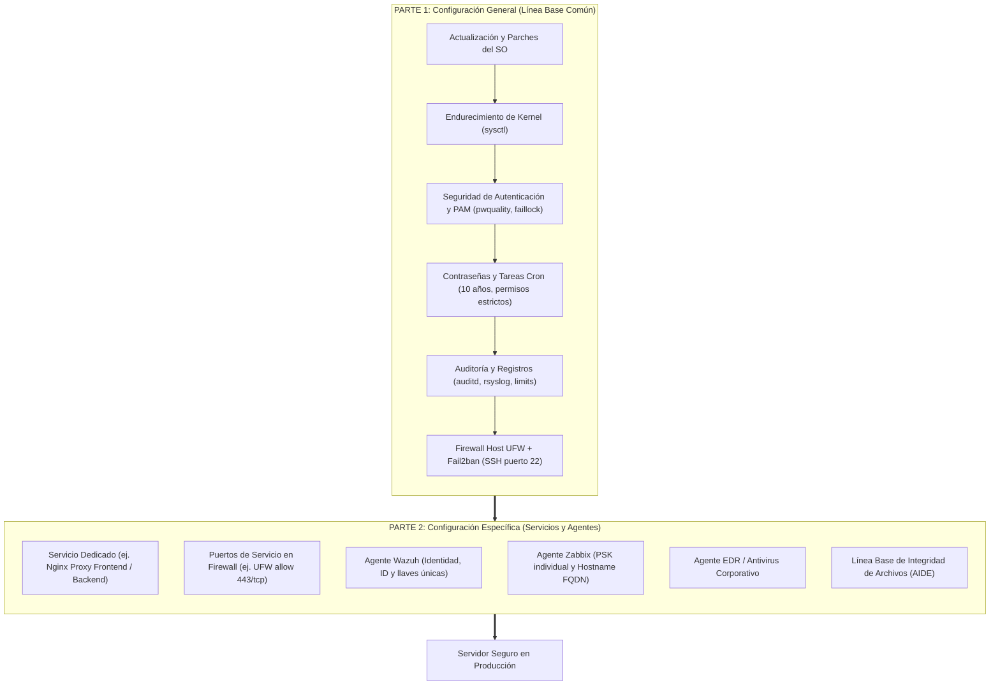

# Hardening y Línea Base de Seguridad para Debian 13 (Trixie)

Guía operativa y automatización de endurecimiento de seguridad para servidores Debian 13 en infraestructura institucional.

> **Objetivo:** Asegurar directamente cada servidor institucional mediante una arquitectura modular en dos partes, eliminando el uso de plantillas genéricas o clonado de imágenes para garantizar identidades, credenciales y registros estrictamente individuales.

---

## 🏗️ Arquitectura de Seguridad en Dos Partes

El modelo de endurecimiento se divide estrictamente en dos fases operativas:



---

## 🧭 Estructura del Manual y Capítulos

### Parte 1: Configuración General (Línea Base Común)
Aplicable de manera homogénea a cualquier servidor Debian 13.

| Capítulo | Enfoque y Controles |
|---|---|
| [01. Preparación del Servidor](docs/01-laboratorio.md) | Sistema operativo base, conectividad, permisos sudo y repositorio. |
| [02. Seguridad Base](docs/02-base.md) | Componentes de seguridad, controles de kernel y verificación. |
| [03. Acceso y Red](docs/03-acceso-red.md) | Acceso administrativo por llaves SSH Ed25519 y restricción perimetral. |
| [09. Base en Bloque](docs/09-base-en-bloque.md) | Ejecución automatizada de la Fase 1 (`bin/configurar_base.py`). |
| [10. Completar Base](docs/10-completar-base.md) | PAM (`pwquality`, `faillock`), rsyslog, auditd, límites core (`bin/completar_base.py`). |
| [11. Cuentas y Cron](docs/11-cuentas-tareas.md) | Expiración de contraseñas a 10 años y permisos estrictos en cron (`bin/cuentas_tareas.py`). |
| [12. Firewall UFW y Fail2ban](docs/12-firewall-ufw.md) | Firewall nativo UFW (`IPv6=no`) integrado a Fail2ban (`banaction = ufw`). |
| [15. Mantenimiento y Parches](docs/guia-mantenimiento-parches-debian.md) | Ciclo de parches APT, depuración de kernels obsoletos y análisis de CVEs. |

### Parte 2: Configuración Específica (Servicios y Agentes)
Aplicable según el rol asignado al servidor (Frontend, Backend, BD, etc.).

| Capítulo | Enfoque y Controles |
|---|---|
| [04. Configuración Específica](docs/04-configuracion-especifica.md) | Separación de roles de red, puertos de servicio y secretos dedicados. |
| [05. Agentes de Seguridad](docs/05-agentes.md) | Enrolamiento individual: Wazuh Agent, Zabbix Agent 2 (PSK), EDR y Antivirus. |
| [06. Perfil Docker](docs/06-docker.md) | Reglas específicas para servidores que ejecuten contenedores. |
| [07. Aceptación Operativa](docs/07-aceptacion-operativa.md) | Pruebas funcionales, matriz de verificación y entrega a producción. |
| [13. Cierre y Verificación](docs/13-cierre-pendiente.md) | Matriz consolidada de controles completados y checklist por servidor. |

---

## ⚡ Guía Rápida de Aplicación en Servidor

### 1. Ejecución de la Parte 1 (Línea Base General)
Desde la terminal del servidor Debian 13 como usuario administrador:

```bash
cd ~/debian13-baseline

# Paso 1: Configuración base del sistema y SSH
sudo python3 bin/configurar_base.py --aplicar --usuario "$USER" --conexion "$SSH_CONNECTION"
# Comprobar acceso en nueva terminal y confirmar:
sudo python3 bin/configurar_base.py --confirmar-ssh

# Paso 2: PAM, rsyslog, auditd y límites de memoria
sudo python3 bin/completar_base.py --aplicar
# Comprobar acceso y confirmar:
sudo python3 bin/completar_base.py --confirmar

# Paso 3: Expiración de contraseñas y permisos de cron
sudo python3 bin/cuentas_tareas.py --aplicar

# Paso 4: Ajustar contraseña a política institucional de 10 años (3650 días)
sudo chage -M 3650 -m 1 -W 365 -I -1 -E -1 "$USER"

# Paso 5: Habilitar Firewall UFW y Fail2ban
sudo ufw default deny incoming
sudo ufw default allow outgoing
sudo ufw allow 22/tcp comment "SSH Administracion"
sudo ufw enable
sudo systemctl restart fail2ban
```

### 2. Ejecución de la Parte 2 (Configuración Específica)

#### A. Si el rol es Proxy Frontend (Nginx HTTPS):
```bash
# Permitir únicamente tráfico HTTPS (puerto 443 TCP)
sudo ufw allow 443/tcp comment "Nginx HTTPS"

# Mantener cerrado el puerto 80 si no se requiere redirección
# Instalar y habilitar Nginx
sudo apt install -y nginx
sudo systemctl enable --now nginx
```

#### B. Registro de Agentes Corporativos (Identidades Únicas):
- **Wazuh Agent:** Inscribir el agente contra el Manager institucional asignando el nombre único del servidor (ej. `srv-proxy01`) y verificando `/var/ossec/etc/client.keys`.
- **Zabbix Agent 2:** Generar PSK local única (`/etc/zabbix/zabbix_agent2.psk`) y registrar en la consola central.
- **Integridad AIDE:** Inicializar la base de firmas una vez instalados los servicios finales:
  ```bash
  sudo aideinit
  sudo cp /var/lib/aide/aide.db.new /var/lib/aide/aide.db
  ```

---

## 🛠️ Administración y Operación Continua

Para la operación diaria del servidor sin repetir la instalación:
- Consulta la guía de [Operación para Infraestructura](docs/00-operacion-infraestructura.md).
- Para el mantenimiento preventivo y resolución de vulnerabilidades detectadas en escáneres (Wazuh/Tenable), consulta la [Guía de Mantenimiento de Parches](docs/guia-mantenimiento-parches-debian.md).

---

## 🔒 Buenas Prácticas de Repositorio y Credenciales

- Este repositorio contiene guías y scripts de automatización.
- **No almacenes en Git:** llaves privadas SSH, tokens de GitHub, contraseñas, archivos PSK de Zabbix, certificados SSL ni llaves de agentes Wazuh.
- Todo secreto debe permanecer exclusivamente en el servidor destino bajo permisos estrictos de sistema de archivos (`0600` / `0400`).
