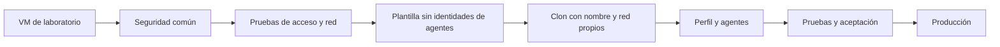

# Debian 13 seguro para Proxmox

**Objetivo:** preparar una base común, convertirla en plantilla y crear servidores con identidad, agentes y seguridad propios para su función.

**Para el encargado de infraestructura:** comenzar por [Operación: estado, firewall, servicios y recuperación](docs/00-operacion-infraestructura.md). Es la guía de administración de una VM ya configurada; no hace falta repetir la instalación.

**Si estás continuando el piloto con contraseña SSH y sin snapshot, usa [9. Aplicar la base en bloque](docs/09-base-en-bloque.md).** Incluye los ajustes acordados durante la configuración y una comprobación al final.

**Si ya completaste el capítulo 9, continúa por [10. Completar PAM, registros y auditoría](docs/10-completar-base.md).** Incluye instalación, aplicación agrupada y recuperación temporal para comprobar una nueva sesión SSH.

Para una instalación nueva desde cero, empieza por [1. Preparar el laboratorio](docs/01-laboratorio.md).

> Edición 0.4: estandarización de Firewall con UFW integrado a Fail2ban, soporte para arquitecturas de Proxy (Frontend/Backend) y guía de mantenimiento de parches.

## El recorrido



## Manual, en orden

| Paso | Qué vas a conseguir |
|---|---|
| [1. Laboratorio](docs/01-laboratorio.md) | VM, repositorio, estado inicial y recuperación |
| [2. Seguridad común](docs/02-base.md) | Componentes, primeros controles, comprobación y reversión |
| [3. Acceso y red](docs/03-acceso-red.md) | SSH por llave y definición de accesos permitidos |
| [4. Plantilla y clones](docs/04-plantilla-clones.md) | Separar configuración común de identidad/secretos |
| [5. Agentes](docs/05-agentes.md) | Wazuh, Zabbix, FortiEDR y condición de soporte G DATA |
| [6. Docker](docs/06-docker.md) | Perfil específico de contenedores y red |
| [7. Aceptación](docs/07-aceptacion-operativa.md) | Evidencias, restauración y entrega del servidor |
| [8. Incorporar CIS](docs/08-reutilizar-cis.md) | Reutilizar Ansible Lockdown con versión fija y controles revisados |
| [9. Base en bloque](docs/09-base-en-bloque.md) | Aplicar el perfil con contraseña, sin Chrony ni snapshot ficticio, y comprobar al final |
| [10. Completar controles](docs/10-completar-base.md) | PAM local, historial y bloqueo, rsyslog, needrestart, auditoría y restricciones adicionales |
| [11. Cuentas y cron](docs/11-cuentas-tareas.md) | Política para cuentas nuevas y permisos de cron, con recuperación |
| [12. Firewall](docs/12-firewall.md) | UFW nativo con Fail2ban, IPv6 desactivado y reglas por función |
| [13. Cierre pendiente](docs/13-cierre-pendiente.md) | Lista consolidada de lo que falta, excepciones y trabajo por clon |
| [14. Preparación de sellado manual](docs/14-preparar-sellado-manual.md) | Comprobaciones antes de limpiar identidades y preparar clones |
| [15. Mantenimiento y Parches](docs/guia-mantenimiento-parches-debian.md) | Buenas prácticas de actualización, kernels y mitigación de vulnerabilidades |

Cada capítulo indica **objetivo, dónde ejecutar, comandos, resultado esperado y qué hacer si falla**. Los nombres `IP_LAB`, `IP_ADMIN`, `FQDN_REAL...` son datos que debes sustituir.

## Qué puede ejecutar hoy

**Ruta actual recomendada para el piloto en curso:** `bin/configurar_base.py`, documentado en el capítulo 9. No mezclar su configuración SSH con el perfil por llave del capítulo 3. La base AIDE se inicializa por clon y el sellado se realiza como operación final separada.

Los comandos siguientes corresponden al **ejecutor inicial 0.2**, que conserva requisitos y alcance distintos:

Desde la carpeta del proyecto, estos comandos solo muestran el plan:

```bash
python3 bin/baseline.py paquetes
python3 bin/baseline.py kernel
```

Tras preparar el laboratorio y su snapshot, dentro de la VM:

```bash
sudo python3 bin/baseline.py paquetes --aplicar --laboratorio --snapshot antes-baseline
sudo python3 bin/baseline.py kernel --aplicar --laboratorio --snapshot antes-baseline
sudo python3 bin/baseline.py verificar
```

**Hace:** instala componentes comunes; aplica y verifica cinco parámetros del kernel; guarda estado privado; permite recuperar la etapa kernel. El nombre del snapshot es una declaración del operador, no una comprobación contra Proxmox.

**Alcance pendiente:** firewall según redes/perfil, integración automática de CIS, políticas completas de auditoría/PAM, automatización de sellado y agentes empresariales. SSH y clonación tienen procedimientos manuales. La instalación de paquetes no demuestra que cada servicio esté configurado y protegiendo correctamente.

El diagnóstico de solo lectura sigue disponible:

```bash
sudo python3 bin/auditar.py --recopilar --salida /root
```

Sus informes son privados. Código 0 significa consultas completadas, 2 resultados que revisar y 1 error de uso/entorno; no otorga una aprobación de seguridad.

## Qué va en cada servidor

| Común a la plantilla | Propio de cada clon |
|---|---|
| Paquetes y políticas revisadas | Nombre, IP, DNS, MAC e identidad del sistema |
| Herramientas y configuración SSH común | Llaves SSH del servidor y credenciales |
| Preparación cloud-init | Registro Wazuh, PSK Zabbix, EDR y antivirus |
| Procedimientos de actualización/auditoría | Aplicación, puertos, datos y referencia AIDE |

Los agentes se registran **antes de aceptar producción**, después de dar identidad al clon. Docker es un perfil separado. Cambiar el nombre/IP no renueva automáticamente los secretos y registros heredados.

## En qué nos apoyamos

[Ansible Lockdown DEBIAN13-CIS](https://github.com/ansible-lockdown/DEBIAN13-CIS) es la referencia principal para ampliar controles; se fijó la release 1.0.3 y su commit en el capítulo 8. OVH, DevSec, Debian y documentación de fabricantes complementan el diseño. Esta edición no ejecuta automáticamente esos roles.

No prometemos un porcentaje de seguridad ni CIS completo. Medimos controles concretos, exposición, funcionamiento, detección y recuperación. **G DATA requiere confirmar soporte del producto/build para Debian 13**; FortiEDR requiere validar Collector y kernel exactos.

<details>
<summary>Documentos de consulta y desarrollo</summary>

- [Diseño técnico](docs/manual.md): decisiones y alcance amplio; los capítulos numerados son el recorrido operativo actual.
- [Revisión de tu script](docs/revision-script.md): problemas detectados y correcciones propuestas.
- [Pruebas detalladas](docs/aceptacion.md): catálogo para ampliar la aceptación.
- [Fuentes](docs/fuentes.md): documentación oficial y límites de la investigación.
- [Inventario de diseño](inventario.ejemplo.yml): ejemplo; todavía no es consumido por el ejecutor.
- [Cambios y validación](CHANGELOG.md): qué existe y qué se ha probado realmente.

Pruebas locales del código, sin ejecutar cambios del sistema:

```bash
python3 -m unittest discover -s tests -v
```

</details>

**GitHub guarda la guía y el código.** No administra automáticamente las VM. Mantén fuera del repositorio informes reales, inventarios de producción, tokens, claves, PSK e instaladores comerciales.
